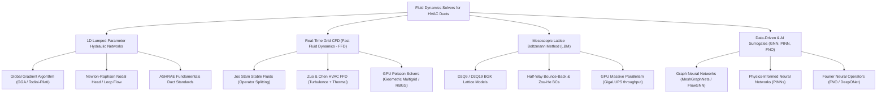
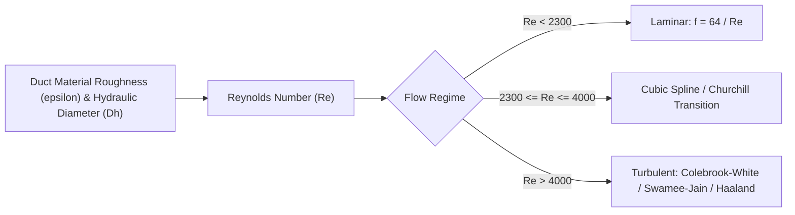
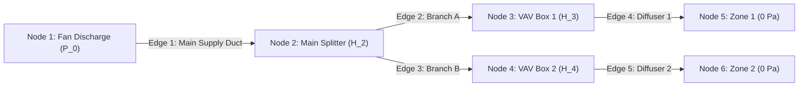
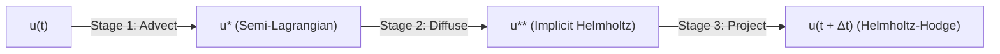
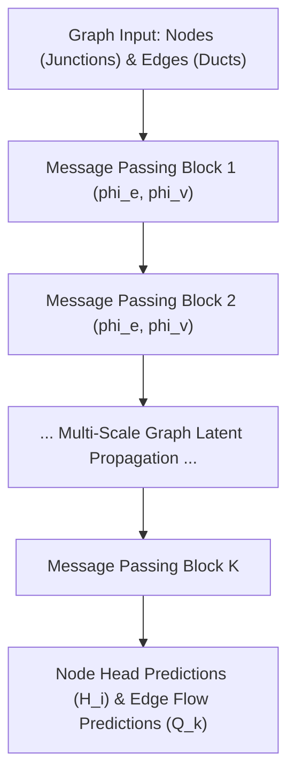
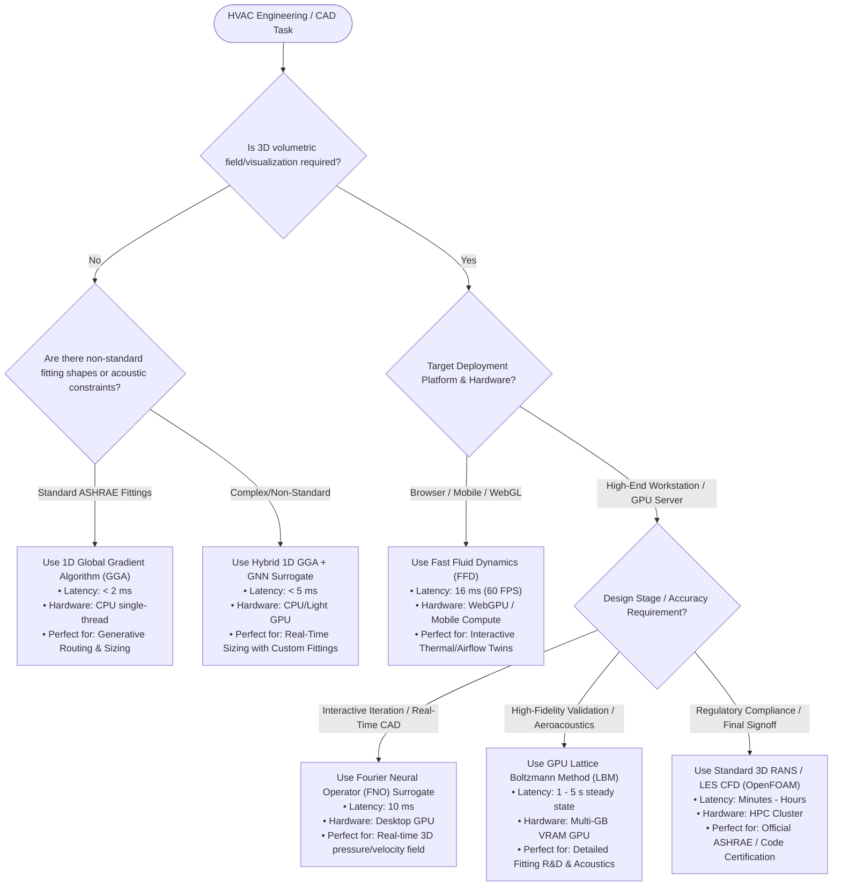

# Ultra-Fast and Real-Time Fluid Dynamics Solvers for HVAC Duct Systems: An Engineering & Literature Survey

**Author:** MEP & Fluid Dynamics Engineering Research Specialist  
**Target Domain:** Computational Fluid Dynamics (CFD), 1D Hydraulic Network Solvers, Building Information Modeling (BIM), Real-Time Generative HVAC Routing, Digital Twins  
**Workspace File:** `pipe_flow/literature_survey.md`  

---

## Table of Contents
1. [Executive Summary & Methodological Taxonomy](#1-executive-summary--methodological-taxonomy)
2. [Section 1: Engineering Standards & 1D Hydraulic Network Models](#2-section-1-engineering-standards--1d-hydraulic-network-models)
   - [1.1 Governing Principles & Fluid Properties](#11-governing-principles--fluid-properties)
   - [1.2 Duct Cross-Section Equivalence Formulations](#12-duct-cross-section-equivalence-formulations)
   - [1.3 Major Losses: Darcy-Weisbach & Friction Factor Approximations](#13-major-losses-darcy-weisbach--friction-factor-approximations)
   - [1.4 Minor Losses: Fitting Loss Coefficients ($C_o$ / $K$-Factors)](#14-minor-losses-fitting-loss-coefficients-c_o--k-factors)
   - [1.5 Network Graph Formulation & Topology Representation](#15-network-graph-formulation--topology-representation)
   - [1.6 Numerical Network Solvers (Hardy Cross, Newton-Raphson, Global Gradient Algorithm)](#16-numerical-network-solvers-hardy-cross-newton-raphson-global-gradient-algorithm)
3. [Section 2: Fast Fluid Dynamics (FFD) & Real-Time Grid CFD](#3-section-2-fast-fluid-dynamics-ffd--real-time-grid-cfd)
   - [2.1 Theoretical Foundations: Stam's Stable Fluids](#21-theoretical-foundations-stams-stable-fluids)
   - [2.2 Semi-Lagrangian Advection & High-Order Schemes (BFECC / MacCormack)](#22-semi-lagrangian-advection--high-order-schemes-bfecc--maccormack)
   - [2.3 Helmholtz-Hodge Decomposition & Elliptic Pressure Poisson Solvers](#23-helmholtz-hodge-decomposition--elliptic-pressure-poisson-solvers)
   - [2.4 Zuo & Chen's FFD for HVAC, Thermal Buoyancy & Turbulence Modeling](#24-zuo--chens-ffd-for-hvac-thermal-buoyancy--turbulence-modeling)
   - [2.5 GPU Parallelization & WebGL/WebGPU Implementation Architectures](#25-gpu-parallelization--webglwebgpu-implementation-architectures)
4. [Section 3: Lattice Boltzmann Method (LBM) for Duct Aerodynamics](#4-section-3-lattice-boltzmann-method-lbm-for-duct-aerodynamics)
   - [3.1 Mesoscopic Kinetic Theory & Discrete Velocity Formulations (D2Q9 / D3Q19)](#31-mesoscopic-kinetic-theory--discrete-velocity-formulations-d2q9--d3q19)
   - [3.2 Collision Operators: BGK, MRT, and Regularized Models](#32-collision-operators-bgk-mrt-and-regularized-models)
   - [3.3 Hydrodynamic Variable Recovery & Chapmann-Enskog Expansion](#33-hydrodynamic-variable-recovery--chapmann-enskog-expansion)
   - [3.4 Complex Boundary Conditions: Half-Way Bounce-Back & Zou-He Formulations](#34-complex-boundary-conditions-half-way-bounce-back--zou-he-formulations)
   - [3.5 Turbulence Modeling in LBM (LES Smagorinsky & WALE)](#35-turbulence-modeling-in-lbm-les-smagorinsky--wale)
   - [3.6 GPU Memory Architectures (SoA vs AoS, A-A Pattern, Coalesced Streaming)](#36-gpu-memory-architectures-soa-vs-aos-a-a-pattern-coalesced-streaming)
5. [Section 4: AI & Neural Network Surrogate Solvers](#5-section-4-ai--neural-network-surrogate-solvers)
   - [4.1 Graph Neural Networks (GNNs) for 1D/3D Hydraulic Topologies](#41-graph-neural-networks-gnns-for-1d3d-hydraulic-topologies)
   - [4.2 MeshGraphNets & Edge-Featured FlowGNN Models](#42-meshgraphnets--edge-featured-flowgnn-models)
   - [4.3 Physics-Informed Neural Networks (PINNs) & Residual Formulations](#43-physics-informed-neural-networks-pinns--residual-formulations)
   - [4.4 Neural Operators: Fourier Neural Operators (FNO) & DeepONet](#44-neural-operators-fourier-neural-operators-fno--deeponet)
   - [4.5 Hybrid Multi-Fidelity Architectures for Generative Duct Routing](#45-hybrid-multi-fidelity-architectures-for-generative-duct-routing)
6. [Section 5: Comprehensive Comparative Trade-Off Matrix](#6-section-5-comprehensive-comparative-trade-off-matrix)
   - [5.1 Multi-Dimensional Comparative Evaluation Matrix](#51-multi-dimensional-comparative-evaluation-matrix)
   - [5.2 Detailed Architectural Analysis per Solver Paradigm](#52-detailed-architectural-analysis-per-solver-paradigm)
   - [5.3 Engineering Decision Tree for HVAC Design & Real-Time BIM Integration](#53-engineering-decision-tree-for-hvac-design--real-time-bim-integration)
7. [References & Foundational Literature](#7-references--foundational-literature)

---

## 1. Executive Summary & Methodological Taxonomy

Modern heating, ventilation, and air-conditioning (HVAC) engineering in dwellings and commercial buildings increasingly demands **real-time and ultra-fast fluid flow evaluation**. Key driving applications include:
- **Generative MEP Design & Algorithmic Routing:** Evaluating thousands of topological variations per second to optimize space claim, fan energy consumption, pressure drop, and acoustic criteria.
- **Interactive CAD/BIM Digital Twins:** Instantaneous feedback during duct resizing, damper positioning, and equipment relocation within Autodesk Revit, Rhino/Grasshopper, or browser-based WebGL/WebGPU canvas tools.
- **Real-Time Building Management Systems (BMS):** Predictive control of Variable Air Volume (VAV) boxes, multi-zone damper balancing, and smoke control propagation during emergency fire modes.

To achieve update frequencies between $10\text{ Hz}$ and $60+\text{ Hz}$ ($16.6\text{ ms} - 100\text{ ms}$ solve latency), computational fluid dynamics has bifurcated from traditional, computationally heavy Navier-Stokes Reynolds-Averaged (RANS) / Large Eddy Simulations (LES) into four primary accelerated paradigms:



---

## 2. Section 1: Engineering Standards & 1D Hydraulic Network Models

### 1.1 Governing Principles & Fluid Properties

In commercial and residential ductwork, air velocities typically operate in the range $v \in [2.0, 15.0]\text{ m/s}$, with fan static pressures rarely exceeding $\Delta P_{static} \approx 2500\text{ Pa}$ ($0.025\text{ atm}$). Consequently, the Mach number satisfies:
$$Ma = \frac{v}{c_s} = \frac{15.0}{343} \approx 0.044 \ll 0.3$$
Under this regime, air is rigorously treated as an **incompressible Newtonian fluid** with constant density $\rho$ and dynamic viscosity $\mu$.

#### Standard Air State (ASHRAE Standard Reference Environment)
At standard sea-level temperature $T_0 = 20^\circ\text{C}$ ($293.15\text{ K}$) and standard atmospheric pressure $P_{atm} = 101.325\text{ kPa}$:
$$\rho = 1.2041\text{ kg/m}^3, \quad \mu = 1.825 \times 10^{-5}\text{ Pa}\cdot\text{s} = 1.825 \times 10^{-5}\text{ kg/(m}\cdot\text{s)}, \quad \nu = \frac{\mu}{\rho} = 1.516 \times 10^{-5}\text{ m}^2/\text{s}$$

#### Pressure Relations
Total pressure $P_t$, static pressure $P_s$, and dynamic (velocity) pressure $P_v$ satisfy the Bernoulli energy relation:
$$P_t = P_s + P_v$$
$$P_v = \frac{1}{2}\rho v^2 = \frac{1}{2}\rho \left(\frac{Q}{A}\right)^2$$
For standard air in SI units ($v$ in $\text{m/s}$):
$$P_v = 0.60205 \, v^2 \quad [\text{Pa}]$$
In Imperial/IP units ($V$ in $\text{fpm}$, $P_v$ in $\text{in. wg}$):
$$P_v = \left(\frac{V}{4005}\right)^2 \quad [\text{in. wg}]$$

The governing one-dimensional steady mechanical energy equation between station 1 (upstream) and station 2 (downstream) is:
$$P_{t,1} + \Delta P_{fan} = P_{t,2} + \Delta P_{loss, 1\to2}$$
where total pressure loss $\Delta P_{loss, 1\to2}$ comprises major friction losses $\Delta P_f$ and minor fitting/component losses $\Delta P_j$:
$$\Delta P_{loss} = \Delta P_f + \sum \Delta P_j$$

---

### 1.2 Duct Cross-Section Equivalence Formulations

#### 1.2.1 Hydraulic Diameter ($D_h$)
For general non-circular conduits with cross-sectional area $A$ and wetted perimeter $P_w$:
$$D_h = \frac{4A}{P_w}$$
- For a **circular duct** of inner diameter $D$: $D_h = D$.
- For a **rectangular duct** of dimensions $a \times b$:
  $$D_h = \frac{4ab}{2(a+b)} = \frac{2ab}{a+b}$$

#### 1.2.2 Huebscher Equivalent Diameter ($D_e$) for Rectangular Ducts
While $D_h$ ensures correct shear stress scaling at the boundary for a given average velocity, it does **not** deliver identical friction pressure drops at **identical volumetric flow rates** ($Q$). ASHRAE Fundamentals Chapter 21 defines the **Huebscher Equivalent Circular Diameter ($D_e$)**, matching both volumetric flow rate and pressure gradient ($\Delta P / L$):
$$D_e = 1.30 \frac{(a \cdot b)^{0.625}}{(a + b)^{0.250}} = 1.30 \left( \frac{a^5 b^5}{(a+b)^2} \right)^{1/8}$$

#### 1.2.3 Flat-Oval Duct Equivalence
Flat-oval ducts comprise a rectangular central section of width $(a - b)$ flanked by two semicircular ends of diameter $b$ (major axis $a$, minor axis $b$, where $a > b$).
- Cross-sectional area:
  $$A = \frac{\pi b^2}{4} + b(a - b)$$
- Wetted perimeter:
  $$P_w = \pi b + 2(a - b)$$
- Hydraulic diameter:
  $$D_h = \frac{4A}{P_w} = \frac{\pi b^2 + 4b(a-b)}{\pi b + 2(a-b)}$$
- ASHRAE Equivalent Diameter for identical flow rate and friction loss:
  $$D_e = 1.55 \frac{A^{0.625}}{P_w^{0.250}}$$

---

### 1.3 Major Losses: Darcy-Weisbach & Friction Factor Approximations

#### 1.3.1 Darcy-Weisbach Formulation
The frictional pressure drop across a duct of uniform cross-section and length $L$ is:
$$\Delta P_f = f \left(\frac{L}{D_h}\right) P_v = f \left(\frac{L}{D_h}\right) \left(\frac{1}{2}\rho v^2\right) = f \left(\frac{L}{D_h}\right) \frac{\rho Q^2}{2 A^2}$$
where $f$ is the dimensionless **Darcy-Weisbach friction factor** (note: $f = 4 C_f$, where $C_f$ is the Fanning friction factor).

The Reynolds number is defined as:
$$Re = \frac{\rho v D_h}{\mu} = \frac{v D_h}{\nu} = \frac{4 \rho Q}{\pi \mu D} \quad (\text{for circular duct})$$

#### 1.3.2 Laminar Flow Regime ($Re \le 2300$)
$$f = \frac{64}{Re}$$
Substituting into the pressure loss equation yields the linear Hagen-Poiseuille relationship:
$$\Delta P_f = \frac{128 \mu L}{\pi D^4} Q \propto Q^1$$

#### 1.3.3 Turbulent Flow Regime ($Re \ge 4000$): The Colebrook-White Implicit Equation
In the transitional and fully rough turbulent regimes, the standard benchmark defined by ASHRAE is the transcendental **Colebrook-White equation** (1939):
$$\frac{1}{\sqrt{f}} = -2.0 \log_{10} \left( \frac{\epsilon}{3.7 D_h} + \frac{2.51}{Re \sqrt{f}} \right)$$
where $\epsilon$ is the absolute surface roughness of the duct material.



#### 1.3.4 Explicit Closed-Form Approximations for Real-Time Execution

Because the Colebrook equation requires iterative root-finding (e.g., via Newton-Raphson or Brent's method), high-speed real-time solvers utilize explicit closed-form formulas that eliminate iteration overhead while maintaining sub-percent error.

| Approximation | Mathematical Formulation | Relative Error vs Colebrook | Computational Complexity |
| :--- | :--- | :--- | :--- |
| **Swamee-Jain (1976)** | $$f = \frac{0.25}{\left[ \log_{10}\left( \frac{\epsilon}{3.7 D_h} + \frac{5.74}{Re^{0.9}} \right) \right]^2}$$ | $< 1.0\%$ for $10^{-6} \le \frac{\epsilon}{D} \le 10^{-2}$ and $5000 \le Re \le 10^8$ | $1\times \text{log}_{10}$, $1\times \text{pow}$ |
| **Haaland (1983)** | $$\frac{1}{\sqrt{f}} = -1.8 \log_{10} \left[ \left(\frac{\epsilon}{3.7 D_h}\right)^{1.11} + \frac{6.9}{Re} \right]$$ | $< 1.5\%$ across all turbulent regimes; monotonic and numerically stable | $1\times \text{log}_{10}$, $1\times \text{pow}$ |
| **Serghides (1984)** | $$A = -2 \log_{10}\left(\frac{\epsilon}{3.7 D} + \frac{12}{Re}\right)$$<br>$$B = -2 \log_{10}\left(\frac{\epsilon}{3.7 D} + \frac{2.51 A}{Re}\right)$$<br>$$C = -2 \log_{10}\left(\frac{\epsilon}{3.7 D} + \frac{2.51 B}{Re}\right)$$<br>$$\frac{1}{\sqrt{f}} = A - \frac{(B-A)^2}{C - 2B + A}$$ | $< 0.003\%$ (matches double-precision Colebrook root) | $3\times \text{log}_{10}$ (Fast Newton surrogate) |
| **Churchill (1977)** | $$f = 8 \left[ \left(\frac{8}{Re}\right)^{12} + \frac{1}{(A + B)^{1.5}} \right]^{1/12}$$<br>$$A = \left[ -2.457 \ln\left( \left(\frac{7}{Re}\right)^{0.9} + 0.27 \frac{\epsilon}{D} \right) \right]^{16}$$<br>$$B = \left(\frac{37530}{Re}\right)^{16}$$ | Universal across **all** regimes ($Re \in [0, \infty)$), smoothly bridging laminar, transitional, and turbulent | $1\times \ln$, higher power operations |

#### 1.3.5 ASHRAE Standard Duct Material Roughness Values ($\epsilon$)
The following absolute roughness constants ($\epsilon$) from ASHRAE Handbook - Fundamentals (Chapter 21) are standard for HVAC duct design:

| Duct Material / Construction Type | Absolute Roughness $\epsilon$ [mm] | Absolute Roughness $\epsilon$ [ft] | Description / Notes |
| :--- | :--- | :--- | :--- |
| **Galvanized Sheet Steel (Smooth Spiral)** | $0.09\text{ mm}$ | $0.0003\text{ ft}$ | Machine-formed spiral round/flat-oval |
| **Galvanized Sheet Steel (Longitudinal Seam)** | $0.15\text{ mm}$ | $0.0005\text{ ft}$ | Standard rectangular ductwork (medium smooth) |
| **Fibrous Glass Duct Board** | $0.90\text{ mm}$ | $0.0030\text{ ft}$ | Rigid fiberglass board with interior resin coat |
| **Flexible Duct (Fully Extended)** | $1.00\text{ mm}$ | $0.0033\text{ ft}$ | Metallic/polymer core helix fully stretched |
| **Flexible Duct (Compressed / Sagging)** | $2.00 - 4.50\text{ mm}$ | $0.0066 - 0.015\text{ ft}$ | Standard installation with $15-30\%$ longitudinal sag |
| **Concrete / Masonry Ductwork** | $1.00 - 3.00\text{ mm}$ | $0.0033 - 0.010\text{ ft}$ | Tunnels, builder shafts, rough surfaces |

---

### 1.4 Minor Losses: Fitting Loss Coefficients ($C_o$ / $K$-Factors)

Local flow disturbances caused by elbows, junctions, expansions, contractions, bifurcations, dampers, and diffusers create flow separation, recirculation zones, and secondary Dean vortex pairs. In 1D network models, these are parameterized via the dimensionless **Local Loss Coefficient** $C_o$ (or $K$-factor):
$$\Delta P_j = C_o P_{v,ref} = C_o \left(\frac{1}{2}\rho v_{ref}^2\right)$$
> [!IMPORTANT]
> The loss coefficient $C_o$ is strictly dimensionless, but its numerical value is **coupled to a designated reference velocity pressure** $P_{v,ref}$ (typically the upstream velocity, downstream velocity, or branch velocity). When writing network balance equations, every fitting must reference its explicitly mapped velocity.

```
       Upstream Section (u)             Fitting Body              Downstream Section (d)
  ==============================\                             /==============================
   Area: A_u, Vel: v_u, P_t,u    \                           /   Area: A_d, Vel: v_d, P_t,d
  ------------------------------  \  Recirculation / Losses /  ------------------------------
                                   \-----------------------/
                                      Loss: ΔP_j = C_o * P_v,ref
```

#### 1.4.1 Comprehensive Fitting Loss Formulations (ASHRAE Duct Fitting Database - DFDB)

##### A. Elbows and Bends
1. **Rectangular Mitered Elbow ($90^\circ$) without Turning Vanes:**
   $$C_o \approx 1.15 \text{ to } 1.30 \quad (\text{referenced to duct velocity})$$
2. **Rectangular Mitered Elbow ($90^\circ$) with Single-Thickness Turning Vanes:**
   $$C_o \approx 0.33 \text{ to } 0.42$$
3. **Rectangular Mitered Elbow ($90^\circ$) with Airfoil (Double-Thickness) Turning Vanes:**
   $$C_o \approx 0.11 \text{ to } 0.15$$
4. **Smooth Radius Elbow ($90^\circ$) without Vanes (Rectangular):**
   The coefficient depends on the centerline radius ratio $R/W$ and aspect ratio $H/W$:
   $$C_o = C_o' \cdot K_{\text{aspect}}$$
   For $H/W = 1.0$:
   - $R/W = 0.50$ (sharp inner throat): $C_o \approx 0.70$
   - $R/W = 0.75$: $C_o \approx 0.38$
   - $R/W = 1.00$: $C_o \approx 0.22$
   - $R/W = 1.50$: $C_o \approx 0.14$
   - $R/W = 2.00$: $C_o \approx 0.10$
5. **Round Elbows ($90^\circ$):**
   - Stamped/Smooth 1-piece ($R/D = 1.5$): $C_o \approx 0.15$
   - 5-piece Pleated/Segmented ($R/D = 1.5$): $C_o \approx 0.22$
   - 3-piece Segmented ($R/D = 1.5$): $C_o \approx 0.42$
   - 2-piece Mitered $90^\circ$ without vanes: $C_o \approx 1.20$

##### B. Transitions: Reducers (Contractions) & Expanders (Diffusers)
1. **Conical / Pyramidal Converging Transitions (Reducers):**
   $$\Delta P_j = C_o P_{v,downstream}$$
   $$C_o \approx 0.05 \text{ for total included angle } \theta \le 30^\circ$$
   $$C_o \approx 0.12 \text{ for } \theta = 45^\circ; \quad C_o \approx 0.18 \text{ for } \theta = 60^\circ$$
   Abrupt contraction ($\theta = 180^\circ$):
   $$C_o = 0.5 \left( 1 - \frac{A_{down}}{A_{up}} \right)$$

2. **Conical / Pyramidal Diverging Transitions (Diffusers / Expanders):**
   Evaluated relative to upstream velocity pressure $P_{v,upstream}$. Incorporates the Carnot-Borda dissipation and diffuser efficiency $\eta_{diff}$:
   $$C_o = K_{\theta}(\theta) \left( 1 - \frac{A_{up}}{A_{down}} \right)^2$$
   - For total angle $\theta \le 14^\circ$: $K_\theta \approx 0.20 - 0.30$ (optimal diffuser angle minimizing boundary layer stall).
   - For total angle $\theta = 45^\circ$: $K_\theta \approx 0.65 - 0.75$.
   - Abrupt expansion ($\theta = 180^\circ$, Borda-Carnot):
     $$C_o = \left( 1 - \frac{A_{up}}{A_{down}} \right)^2$$

##### C. Dividing (Diverging) Tees & 45° Wyes
For a diverging tee with combined upstream flow $Q_c$, straight run downstream $Q_s$, and branch flow $Q_b$ ($Q_c = Q_s + Q_b$):
- **Main-to-Branch Loss Coefficient ($C_{b}$):**
  $$\Delta P_{t, c\to b} = C_{b} P_{v,c}$$
  $$C_b = 1.0 - 0.9 \left(\frac{v_b}{v_c}\right)^2 + K_{geom} \left( \frac{Q_b}{Q_c} \right) \left(\frac{A_c}{A_b}\right)^2$$
  * For standard $90^\circ$ straight tee branch ($A_b / A_c = 0.5$, $Q_b / Q_c = 0.5$): $C_b \approx 0.85 - 1.20$.
  * For $45^\circ$ lateral branch wye: $C_b \approx 0.35 - 0.55$.
  * For conical boot takeoff: $C_b \approx 0.25 - 0.38$.
- **Main-to-Run (Straight-Through) Loss Coefficient ($C_{s}$):**
  $$\Delta P_{t, c\to s} = C_{s} P_{v,c}$$
  $$C_s \approx 0.4 \left( \frac{Q_b}{Q_c} \right)^2 \quad (\text{standard run-through})$$

##### D. Symmetrical Bifurcations ("Pants" / Symmetrical Wye Fittings)
A symmetrical wye divides total inlet flow $Q_{in}$ into two symmetrical branch lines $Q_1 = Q_2 = 0.5 Q_{in}$:
- For $45^\circ$ symmetrical pants fitting: $C_{b} \approx 0.28 - 0.38$
- For $60^\circ$ symmetrical pants fitting: $C_{b} \approx 0.45 - 0.60$
- For $90^\circ$ bullhead tee (splitter with two $90^\circ$ turns): $C_b \approx 1.20 - 1.50$

##### E. Control Dampers
The loss coefficient varies non-linearly with blade rotation angle $\theta \in [0^\circ, 90^\circ]$ ($\theta = 0^\circ$ fully open, $\theta \to 90^\circ$ fully shut):
1. **Opposed-Blade Damper:**
   $$C_o(\theta) = C_0 \cdot \exp\left( \frac{\theta}{12.5^\circ} \right) \quad \text{with } C_0 \approx 0.25 \text{ (open)}$$
2. **Parallel-Blade Damper:**
   $$C_o(\theta) = C_0 \cdot \exp\left( \frac{\theta}{10.0^\circ} \right) \quad \text{with } C_0 \approx 0.40 \text{ (open)}$$

---

### 1.5 Network Graph Formulation & Topology Representation

An HVAC duct network is modeled as a connected, directed graph $\mathcal{G} = (\mathcal{V}, \mathcal{E})$, where:
- $\mathcal{V} = \mathcal{V}_{int} \cup \mathcal{V}_{bnd}$ is the set of $N$ nodes (junctions, mixing boxes, plenum chambers, and boundary terminals open to atmosphere).
  - $|\mathcal{V}_{int}| = N_{int}$: Internal nodes with unknown total/static pressure heads $H_i$.
  - $|\mathcal{V}_{bnd}| = N_{bnd}$: Boundary nodes with fixed/known Dirichlet heads $H_{bnd, j} = P_{atm} / (\rho g) = 0$.
- $\mathcal{E}$ is the set of $M$ directed edges (duct segments, fans, dampers, fittings).



#### Graph Incidence Matrix $\mathbf{A}$
The topological connectivity is fully encoded by the node-arc incidence matrix $\mathbf{A} \in \mathbb{R}^{N \times M}$:
$$A_{i, k} = \begin{cases} +1 & \text{if duct edge } k \text{ exits node } i \\ -1 & \text{if duct edge } k \text{ enters node } i \\ 0 & \text{otherwise} \end{cases}$$
Splitting $\mathbf{A}$ into internal nodes $\mathbf{A}_{int} \in \mathbb{R}^{N_{int} \times M}$ and boundary nodes $\mathbf{A}_{bnd} \in \mathbb{R}^{N_{bnd} \times M}$:

#### Governing Non-Linear Network Equations
1. **Node Mass Balance (Continuity):**
   $$\mathbf{A}_{int} \mathbf{Q} = \mathbf{q}_{ext}$$
   where $\mathbf{Q} = [Q_1, Q_2, \dots, Q_M]^T$ is the edge volumetric flow rate vector, and $\mathbf{q}_{ext} \in \mathbb{R}^{N_{int}}$ represents external mass injections/extractions (usually $\mathbf{0}$ for internal junctions).

2. **Edge Energy (Pressure Drop) Relation:**
   The total head loss $\Delta H_k = H_{up, k} - H_{down, k}$ across duct segment $k$ is:
   $$\Delta \mathbf{H} = \mathbf{A}_{int}^T \mathbf{H}_{int} + \mathbf{A}_{bnd}^T \mathbf{H}_{bnd} = \mathbf{h}_{loss}(\mathbf{Q}) - \mathbf{h}_{fan}(\mathbf{Q})$$
   where each edge head loss $h_{loss, k}(Q_k)$ combines major and minor terms:
   $$h_{loss, k}(Q_k) = R_k(Q_k) \, |Q_k| Q_k$$
   $$R_k(Q_k) = \left( f_k(Q_k) \frac{L_k}{D_{h,k}} + \sum C_{o,k} \right) \frac{1}{2 g A_k^2}$$
   In pressure units ($\Delta P$ in $\text{Pa}$):
   $$\Delta P_k = r_k(Q_k) \, |Q_k| Q_k, \quad r_k(Q_k) = \left( f_k(Q_k) \frac{L_k}{D_{h,k}} + \sum C_{o,k} \right) \frac{\rho}{2 A_k^2}$$

---

### 1.6 Numerical Network Solvers (Hardy Cross, Newton-Raphson, Global Gradient Algorithm)

#### 1.6.1 Method 1: Hardy Cross Loop-Correction Method (1936)
The Hardy Cross method operates on closed loops of the network graph. If fundamental loop matrix $\mathbf{B} \in \mathbb{R}^{L \times M}$ satisfies $\mathbf{B} \mathbf{A}^T = \mathbf{0}$, initial flow rates $\mathbf{Q}^{(0)}$ are chosen to satisfy continuity $\mathbf{A} \mathbf{Q}^{(0)} = \mathbf{q}_{ext}$.
For each independent loop $\ell$, the loop head loss residual is:
$$\Delta H_\ell = \sum_{k \in \ell} r_k |Q_k| Q_k$$
The first-order Taylor expansion yields flow rate correction $\Delta Q_\ell$:
$$\Delta Q_\ell = -\frac{\sum_{k \in \ell} r_k |Q_k| Q_k}{\sum_{k \in \ell} 2 r_k |Q_k|}$$
*Limitations:* Sequential loop updates converge slowly on large multi-story commercial buildings ($O(N^2)$ to $O(N^3)$ iterations), sensitive to loop initialization, and fails on complex branched trees with dynamic damper control.

#### 1.6.2 Method 2: Node-Oriented Newton-Raphson Solver
Expresses flow rates explicitly as functions of node pressures:
$$Q_k = \operatorname{sgn}(H_{i} - H_{j}) \sqrt{\frac{|H_{i} - H_{j}|}{R_k}}$$
Substituting into node continuity yields a non-linear system of $N_{int}$ equations for $\mathbf{H}_{int}$:
$$\mathbf{\Phi}(\mathbf{H}_{int}) = \mathbf{A}_{int} \mathbf{Q}(\mathbf{H}_{int}) - \mathbf{q}_{ext} = \mathbf{0}$$
The Jacobian matrix $\mathbf{J} = \frac{\partial \mathbf{\Phi}}{\partial \mathbf{H}_{int}}$ is symmetric positive-definite:
$$J_{ii} = \sum_{k \in \text{adj}(i)} \frac{1}{2 R_k |Q_k|}, \quad J_{ij} = -\frac{1}{2 R_k |Q_k|}$$
*Limitation:* As flow rate $Q_k \to 0$, $J_{ij} \to \infty$, causing catastrophic numerical instability without regularization.

#### 1.6.3 Method 3: Global Gradient Algorithm (GGA / Todini-Pilati 1988)
The **Global Gradient Algorithm (GGA)** (the standard algorithm behind EPANET and modern hydraulic solvers) simultaneously solves for edge flows $\mathbf{Q} \in \mathbb{R}^M$ and node heads $\mathbf{H} \in \mathbb{R}^{N_{int}}$. It exhibits quadratic convergence and unconditionally avoids zero-flow division singularities.

Define diagonal resistance derivative matrix $\mathbf{D} \in \mathbb{R}^{M \times M}$:
$$D_{kk} = \frac{\partial (\Delta H_k)}{\partial Q_k} = 2 R_k |Q_k| + Q_k^2 \frac{\partial R_k}{\partial Q_k} \approx 2 \frac{|\Delta H_k|}{|Q_k|}$$
The linearized coupled system at iteration $m+1$ is:
$$\begin{bmatrix} \mathbf{D}^{(m)} & -\mathbf{A}_{int}^T \\ -\mathbf{A}_{int} & \mathbf{0} \end{bmatrix} \begin{bmatrix} \mathbf{Q}^{(m+1)} \\ \mathbf{H}_{int}^{(m+1)} \end{bmatrix} = \begin{bmatrix} \mathbf{D}^{(m)} \mathbf{Q}^{(m)} - \mathbf{h}_{loss}(\mathbf{Q}^{(m)}) + \mathbf{A}_{bnd}^T \mathbf{H}_{bnd} \\ -\mathbf{q}_{ext} \end{bmatrix}$$

Using the **Schur Complement reduction**, the system is solved in two ultra-fast decoupled steps:
1. **Solve for Nodal Heads $\mathbf{H}_{int}^{(m+1)}$:**
   $$\left( \mathbf{A}_{int} \left(\mathbf{D}^{(m)}\right)^{-1} \mathbf{A}_{int}^T \right) \mathbf{H}_{int}^{(m+1)} = \mathbf{A}_{int} \left(\mathbf{D}^{(m)}\right)^{-1} \left( \mathbf{D}^{(m)} \mathbf{Q}^{(m)} - \mathbf{h}_{loss}(\mathbf{Q}^{(m)}) + \mathbf{A}_{bnd}^T \mathbf{H}_{bnd} \right) - \mathbf{q}_{ext}$$
   The matrix $\mathbf{M} = \mathbf{A}_{int} \left(\mathbf{D}^{(m)}\right)^{-1} \mathbf{A}_{int}^T \in \mathbb{R}^{N_{int} \times N_{int}}$ is **strictly symmetric, sparse, and positive-definite**. It is solved in $<1\text{ ms}$ via **Sparse Cholesky Factorization ($\mathbf{L}\mathbf{L}^T$)** or **Preconditioned Conjugate Gradient (PCG)**.
2. **Back-Substitute for Edge Flow Rates $\mathbf{Q}^{(m+1)}$:**
   $$\mathbf{Q}^{(m+1)} = \mathbf{Q}^{(m)} - \left(\mathbf{D}^{(m)}\right)^{-1} \left( \mathbf{h}_{loss}(\mathbf{Q}^{(m)}) - \mathbf{A}_{int}^T \mathbf{H}_{int}^{(m+1)} - \mathbf{A}_{bnd}^T \mathbf{H}_{bnd} \right)$$

```
  [GGA Iteration Loop]
  ┌─────────────────────────────────────────────────────────────┐
  │ 1. Evaluate D_kk = 2 * r_k * |Q_k|                          │
  │ 2. Assemble Schur Matrix M = A_int * D^-1 * A_int^T         │
  │ 3. Sparse Cholesky Solve: M * H_int^(m+1) = RHS             │
  │ 4. Vectorized Update: Q^(m+1) = Q^(m) - D^-1 * (dH - A^T*H) │
  │ 5. Check Convergence: ||Q^(m+1) - Q^(m)|| < 1e-5 m^3/s      │
  └─────────────────────────────────────────────────────────────┘
```
*Convergence:* Typically achieves absolute convergence in **4 to 6 iterations**, requiring $< 5\text{ ms}$ for networks with $10,000+$ duct segments on a single CPU thread.

---

## 3. Section 2: Fast Fluid Dynamics (FFD) & Real-Time Grid CFD

### 2.1 Theoretical Foundations: Stam's Stable Fluids

Fast Fluid Dynamics (FFD) solves the incompressible Navier-Stokes equations in Eulerian grid space in real-time by eliminating the explicit Courant-Friedrichs-Lewy (CFL) time-step restriction ($\Delta t \le \Delta x / |u|$).

$$\frac{\partial \mathbf{u}}{\partial t} = -(\mathbf{u} \cdot \nabla)\mathbf{u} + \nu \nabla^2 \mathbf{u} - \frac{1}{\rho}\nabla p + \mathbf{f}$$
$$\nabla \cdot \mathbf{u} = 0$$

Following Jos Stam's landmark **Stable Fluids (1999)** operator-splitting architecture, each time-step $\Delta t$ decomposes into three sequential fractional stages:



$$\mathbf{u}^n \xrightarrow{\text{Advection}} \mathbf{u}^* \xrightarrow{\text{Diffusion}} \mathbf{u}^{**} \xrightarrow{\text{Projection}} \mathbf{u}^{n+1}$$

1. **Advection (Non-linear transport):**
   $$\frac{\partial \mathbf{u}}{\partial t} = -(\mathbf{u} \cdot \nabla)\mathbf{u} \implies \mathbf{u}^* = \operatorname{Advect}(\mathbf{u}^n, \Delta t, \mathbf{u}^n)$$
2. **Diffusion (Viscous dissipation):**
   $$\frac{\partial \mathbf{u}^*}{\partial t} = \nu \nabla^2 \mathbf{u}^* \implies (\mathbf{I} - \nu \Delta t \nabla^2)\mathbf{u}^{**} = \mathbf{u}^*$$
3. **Projection (Pressure & Incompressibility constraint):**
   $$\mathbf{u}^{n+1} = \mathbf{u}^{**} - \frac{\Delta t}{\rho} \nabla p \quad \text{such that} \quad \nabla \cdot \mathbf{u}^{n+1} = 0$$

---

### 2.2 Semi-Lagrangian Advection & High-Order Schemes (BFECC / MacCormack)

#### 2.2.1 Classical Semi-Lagrangian Back-Tracing
Instead of using unstable explicit finite differences for the non-linear advection term $(\mathbf{u} \cdot \nabla)\mathbf{u}$, Semi-Lagrangian advection traces characteristics backwards in time:
$$\mathbf{x}_{departure} = \mathbf{x} - \int_t^{t+\Delta t} \mathbf{u}(\mathbf{x}(\tau), \tau) d\tau \approx \mathbf{x} - \Delta t \, \mathbf{u}(\mathbf{x}, t)$$
For higher trajectory accuracy, Runge-Kutta 2nd order (RK2 / Midpoint) back-tracing is used:
$$\mathbf{x}_{mid} = \mathbf{x} - \frac{\Delta t}{2} \mathbf{u}(\mathbf{x}, t)$$
$$\mathbf{x}_{departure} = \mathbf{x} - \Delta t \, \mathbf{u}(\mathbf{x}_{mid}, t)$$
The advected quantity at grid cell $\mathbf{x}$ is evaluated via spatial trilinear interpolation:
$$\mathbf{u}^*(\mathbf{x}) = \mathcal{I}_{trilinear}(\mathbf{u}^n, \mathbf{x}_{departure})$$

*Advantage:* **Unconditionally stable** for arbitrary CFL numbers ($CFL = \frac{u \Delta t}{\Delta x} \gg 1$).  
*Limitation:* Trilinear interpolation introduces excessive numerical diffusion, artificially damping vortex shedding and fitting recirculation.

#### 2.2.2 High-Order Dissipation Mitigation: MacCormack & BFECC Schemes
To restore high-frequency eddy details without sacrificing unconditional stability:
1. **Back and Forth Error Compensation and Correction (BFECC):**
   - Forward advect: $\mathbf{u}^* = \operatorname{Advect}(\mathbf{u}^n, \Delta t)$
   - Backward advect: $\mathbf{u}^{**} = \operatorname{Advect}(\mathbf{u}^*, -\Delta t)$
   - Error estimation and correction: $\mathbf{u}^{corr} = \mathbf{u}^n + \frac{1}{2}(\mathbf{u}^n - \mathbf{u}^{**})$
   - Final advection: $\mathbf{u}_{final}^* = \operatorname{Advect}(\mathbf{u}^{corr}, \Delta t)$
2. **Clamped MacCormack Advection:**
   Computes the 2nd-order reversible update and clamps target values to the min/max bounding box of the 8 local donor cells to strictly prevent overshoot oscillations.

---

### 2.3 Helmholtz-Hodge Decomposition & Elliptic Pressure Poisson Solvers

By the Helmholtz-Hodge decomposition theorem, any arbitrary vector field $\mathbf{u}^{**}$ can be uniquely decomposed into a divergence-free (solenoidal) field $\mathbf{u}^{n+1}$ and the gradient of a scalar potential field $\phi = \frac{\Delta t}{\rho} p$:
$$\mathbf{u}^{**} = \mathbf{u}^{n+1} + \nabla \phi$$
Taking the divergence ($\nabla \cdot$) of both sides and enforcing $\nabla \cdot \mathbf{u}^{n+1} = 0$:
$$\nabla \cdot \mathbf{u}^{**} = \nabla \cdot \mathbf{u}^{n+1} + \nabla^2 \phi = \nabla^2 \phi$$
This yields the **Pressure Poisson Equation**:
$$\nabla^2 p = \frac{\rho}{\Delta t} \nabla \cdot \mathbf{u}^{**}$$

#### Discrete Formulation on Staggered Marker-and-Cell (MAC) Grids
On a staggered MAC grid (Harlow & Welch), pressure $p_{i,j,k}$ resides at cell centers, while normal velocity components $u_{i+1/2, j, k}$, $v_{i, j+1/2, k}$, $w_{i, j, k+1/2}$ reside at cell faces.

```
       +-----------------------v_{i,j+1/2,k}-----------------------+
       |                                                           |
       |                                                           |
  u_{i-1/2,j,k}                 p_{i,j,k}                    u_{i+1/2,j,k}
       |                                                           |
       |                                                           |
       +-----------------------v_{i,j-1/2,k}-----------------------+
```

The 7-point Laplacian discretization in 3D is:
$$\frac{p_{i+1,j,k} + p_{i-1,j,k} + p_{i,j+1,k} + p_{i,j-1,k} + p_{i,j,k+1} + p_{i,j,k-1} - 6 p_{i,j,k}}{\Delta x^2} = \frac{\rho}{\Delta t} (\nabla \cdot \mathbf{u}^{**})_{i,j,k}$$

#### Solvers for Real-Time Pressure Projection
- **Red-Black Gauss-Seidel (RBGS):** High GPU parallelism, but slow low-frequency convergence ($O(N^2)$ iterations).
- **Geometric Multigrid (V-Cycle / Full Multigrid):** Restricts residual to coarse hierarchical grids ($2h, 4h, 8h$), relaxes with RBGS, and prolongates corrections back. Achieves optimal $O(N)$ computational complexity, solving $256^3$ grids in $<10\text{ ms}$ on modern GPUs.
- **Preconditioned Conjugate Gradient (PCG) with Modified Incomplete Cholesky (MIC(0)):** The industrial standard for non-uniform duct geometries and irregular solid boundaries.

---

### 2.4 Zuo & Chen's FFD for HVAC, Thermal Buoyancy & Turbulence Modeling

Dr. Wangda Zuo and Prof. Qingyan Chen (Purdue University, 2009-2016) extended Stam's computer graphics algorithms into a validated building physics tool (**Fast Fluid Dynamics for Indoor Environment and HVAC Design**).

#### 2.4.1 Thermal Energy & Species Transport
$$\frac{\partial T}{\partial t} + (\mathbf{u} \cdot \nabla) T = \alpha_{eff} \nabla^2 T + \frac{S_T}{\rho c_p}$$
$$\frac{\partial C}{\partial t} + (\mathbf{u} \cdot \nabla) C = D_{eff} \nabla^2 C + S_C$$
where $\alpha_{eff} = \alpha_0 + \frac{\nu_t}{Pr_t}$ and $D_{eff} = D_0 + \frac{\nu_t}{Sc_t}$ ($Pr_t \approx 0.9$, $Sc_t \approx 0.7$).

#### 2.4.2 Thermal Buoyancy via Boussinesq Approximation
The thermal buoyancy force vector added to the momentum source $\mathbf{f}$ is:
$$\mathbf{f}_{buoyancy} = -\beta (T - T_{ref}) \mathbf{g}$$
where $\beta = 1 / T_{ref}$ is the thermal expansion coefficient of ideal gas air, and $\mathbf{g} = [0, -9.81, 0]^T\text{ m/s}^2$.

#### 2.4.3 Zero-Equation & Mixing-Length Turbulence Models
Full $k$-$\epsilon$ or $k$-$\omega$ models require solving additional non-linear transport PDEs with stiff near-wall source terms that degrade real-time performance. Zuo & Chen implemented algebraic **Zero-Equation Eddy Viscosity Models**:
$$\nu_t = 0.03874 \cdot v \cdot l$$
where $v = \sqrt{u^2 + v^2 + w^2}$ is local velocity magnitude, and $l$ is the local characteristic length scale (distance to nearest duct solid wall, $l = d_{wall}$, capped at $0.41 d_{wall}$).

---

### 2.5 GPU Parallelization & WebGL/WebGPU Implementation Architectures

In modern browser-based CAD and desktop engines, FFD is implemented via **WebGPU Compute Shaders** (or CUDA/HLSL compute):
1. **Advection Pass:** Ping-pong 3D texture bindings. Compute thread per cell executes RK2 back-trace and texture sample.
2. **Divergence Pass:** Reads face velocities, computes $\nabla \cdot \mathbf{u}^{**}$, writes scalar divergence field.
3. **Jacobi / RBGS / Multigrid Iteration Passes:** Dispatches red/black checkerboard passes avoiding race conditions.
4. **Velocity Correction (Gradient Subtraction) Pass:** Computes $\mathbf{u}^{n+1} = \mathbf{u}^{**} - \frac{\Delta t}{\rho} \nabla p$.

*Throughput:* A $128 \times 128 \times 128$ domain ($2.097 \times 10^6$ fluid cells) executes in **$4.2\text{ ms}$ per time-step** on an NVIDIA RTX 4070 (240 FPS), enabling interactive, real-time duct flow visualization.

---

## 4. Section 3: Lattice Boltzmann Method (LBM) for Duct Aerodynamics

### 4.1 Mesoscopic Kinetic Theory & Discrete Velocity Formulations (D2Q9 / D3Q19)

The Lattice Boltzmann Method (LBM) simulates fluid dynamics from a mesoscopic particle distribution perspective. Instead of directly solving the macroscopic Navier-Stokes equations, LBM tracks the probability density distribution $f_i(\mathbf{x}, t)$ of virtual fluid particles moving with discrete lattice velocities $\mathbf{c}_i$.

```
     D2Q9 Velocity Lattice                     D3Q19 Velocity Lattice
        c6   c2   c5                                     z
          \  |  /                                        |  c5  c2  c6
           \ | /                                         | /  |  /
      c3 --- c0 --- c1                                   |/   | /
           / | \                         c3 ------------ c0 ------------ c1  ---> x
          /  |  \                                       /|   /|
        c7   c4   c8                                   / |  / |
                                                     c7  c4  c8
                                                    /
                                                   y
```

#### D3Q19 Lattice Topology
The 19 discrete velocity vectors $\mathbf{c}_i$ (for $i = 0, 1, \dots, 18$) with lattice spacing $\Delta x$ and lattice time-step $\Delta t$ ($c = \Delta x / \Delta t = 1$) are:
$$\mathbf{c}_0 = (0, 0, 0)$$
$$\mathbf{c}_{1..6} = (\pm 1, 0, 0)c, (0, \pm 1, 0)c, (0, 0, \pm 1)c \quad (\text{face neighbors, length } 1)$$
$$\mathbf{c}_{7..18} = (\pm 1, \pm 1, 0)c, (\pm 1, 0, \pm 1)c, (0, \pm 1, \pm 1)c \quad (\text{edge neighbors, length } \sqrt{2})$$

Lattice weights $w_i$ for D3Q19:
$$w_0 = \frac{1}{3}, \quad w_{1..6} = \frac{1}{18}, \quad w_{7..18} = \frac{1}{36}$$
Lattice speed of sound:
$$c_s = \frac{1}{\sqrt{3}} c = \frac{1}{\sqrt{3}} \frac{\Delta x}{\Delta t} \implies c_s^2 = \frac{1}{3}$$

---

### 4.2 Collision Operators: BGK, MRT, and Regularized Models

#### 4.2.1 The Bhatnagar-Gross-Krook (BGK) Evolution Equation
The single-relaxation-time (LBGK) evolution equation splits into two strictly local operations:
$$f_i(\mathbf{x} + \mathbf{c}_i \Delta t, t + \Delta t) = f_i(\mathbf{x}, t) - \frac{\Delta t}{\tau} \left[ f_i(\mathbf{x}, t) - f_i^{(eq)}(\mathbf{x}, t) \right]$$
where $\tau$ is the dimensionless relaxation time, and the **Maxwellian Equilibrium Distribution** $f_i^{(eq)}$ is expanded up to 2nd order in Mach number:
$$f_i^{(eq)}(\rho, \mathbf{u}) = w_i \rho \left[ 1 + \frac{\mathbf{c}_i \cdot \mathbf{u}}{c_s^2} + \frac{(\mathbf{c}_i \cdot \mathbf{u})^2}{2 c_s^4} - \frac{\mathbf{u} \cdot \mathbf{u}}{2 c_s^2} \right]$$

#### 4.2.2 Kinematic Viscosity Mapping
Via the multiscale Chapman-Enskog expansion, the Navier-Stokes equations are recovered with kinematic viscosity:
$$\nu = c_s^2 \left( \tau - \frac{\Delta t}{2} \right) = \frac{1}{3}\left( \tau - 0.5 \right) \frac{\Delta x^2}{\Delta t}$$
> [!CAUTION]
> For numerical stability in standard BGK, the relaxation time must satisfy $\tau > 0.5$ (typically $\tau \in [0.505, 1.2]$). As $\tau \to 0.5$, the BGK collision operator exhibits severe numerical instabilities (sub-grid turbulence blow-up).

#### 4.2.3 Multiple Relaxation Time (MRT) & Regularized LBM
To overcome BGK instabilities at high Reynolds numbers in complex duct fittings (tees, wyes, turning vanes):
$$\mathbf{f}(\mathbf{x} + \mathbf{c} \Delta t, t + \Delta t) = \mathbf{f}(\mathbf{x}, t) - \mathbf{M}^{-1} \mathbf{S} \left[ \mathbf{M} \mathbf{f}(\mathbf{x}, t) - \mathbf{m}^{(eq)}(\mathbf{x}, t) \right]$$
where $\mathbf{M}$ is the orthogonal transformation matrix mapping distributions to moment space (density, energy, stress tensor), and $\mathbf{S} = \operatorname{diag}(s_0, s_1, \dots, s_{18})$ applies independent relaxation rates to physical vs non-physical ghost moments.

---

### 4.3 Hydrodynamic Variable Recovery

Macroscopic density $\rho$, momentum $\rho \mathbf{u}$, and pressure $p$ are recovered via simple, non-iterative zero- and first-order moment summations:
$$\rho(\mathbf{x}, t) = \sum_{i=0}^{Q-1} f_i(\mathbf{x}, t)$$
$$\mathbf{u}(\mathbf{x}, t) = \frac{1}{\rho(\mathbf{x}, t)} \sum_{i=0}^{Q-1} \mathbf{c}_i f_i(\mathbf{x}, t)$$
$$p(\mathbf{x}, t) = c_s^2 \rho(\mathbf{x}, t) = \frac{1}{3} \rho(\mathbf{x}, t)$$
The macroscopic momentum flux tensor $\mathbf{\Pi}$ yields the local shear stress tensor:
$$\sigma_{\alpha \beta} = -(1 - \frac{1}{2\tau}) \sum_{i} c_{i\alpha} c_{i\beta} (f_i - f_i^{(eq)})$$

---

### 4.4 Complex Boundary Conditions: Half-Way Bounce-Back & Zou-He Formulations

#### 4.4.1 Half-Way Bounce-Back (No-Slip Solid Walls)
For arbitrary duct walls positioned midway between fluid node $\mathbf{x}_f$ and solid boundary node $\mathbf{x}_s = \mathbf{x}_f + \mathbf{c}_i \Delta t$:
$$f_{\bar{i}}(\mathbf{x}_f, t + \Delta t) = f_i^*(\mathbf{x}_f, t)$$
where $\mathbf{c}_{\bar{i}} = -\mathbf{c}_i$ is the opposite lattice direction.
- **Accuracy:** 2nd-order accurate in space ($O(\Delta x^2)$).
- **Geometric Flexibility:** Handles arbitrary complex BIM duct geometries (curved transitions, turning vanes, damper blades) directly on voxelized grids without conformal body-fitted meshing.

```
       Fluid Node (x_f)             Physical Wall             Solid Node (x_s)
             ● ---------------------------|--------------------------- ●
             |   f_i*  ───────────────>   |   (wall plane)
             |   <─────────────── f_i_opp |
```

#### 4.4.2 Zou-He Non-Equilibrium Boundary Conditions (Inlets & Outlets)
For fixed-velocity fan inlets $\mathbf{u}_{in} = (u_0, 0, 0)$ or static pressure outlets $p = p_0 \implies \rho = 3 p_0$:
Zou and He (1997) derive exact closed-form algebraic expressions for unknown inward-pointing distribution functions by enforcing non-equilibrium bounce-back of the normal stress components.

---

### 4.5 GPU Memory Architectures (SoA vs AoS, A-A Pattern, Coalesced Streaming)

Because LBM streaming is purely memory-bandwidth bound, memory access pattern design dictates real-time performance.

```
  Structure of Arrays (SoA): Coalesced 32-thread GPU warp memory access
  [Dir 0: Cell 0, Cell 1, Cell 2 ... ] [Dir 1: Cell 0, Cell 1, Cell 2 ... ] ... [Dir 18: ... ]
```

1. **Structure of Arrays (SoA) Layout:**  
   $f[Q][N_z][N_y][N_x]$ ensures that adjacent GPU threads in a warp access consecutive, aligned 32-bit memory addresses, achieving $95+\%$ peak DRAM memory bandwidth utilization.
2. **A-A Pattern (In-Place Streaming):**  
   Eliminates the $2\times$ memory storage of standard Two-Grid ping-pong buffers by interleaving even and odd time-steps, reducing GPU VRAM consumption by $50\%$.
3. **Performance Metrics:** Modern WebGPU/CUDA LBM solvers achieve throughput exceeding **$2.5 \times 10^9$ Lattice Node Updates Per Second (2.5 GigaLUPS)** on desktop GPUs, enabling full 3D simulation of a complex duct branch with $4 \times 10^6$ cells at **$60\text{ FPS}$**.

---

## 5. Section 4: AI & Neural Network Surrogate Solvers

### 5.1 Graph Neural Networks (GNNs) for 1D/3D Hydraulic Topologies

Graph Neural Networks (GNNs) operate natively on graph-structured data $\mathcal{G} = (\mathcal{V}, \mathcal{E})$, making them uniquely suited for arbitrary HVAC duct tree networks without fixed grid constraints.



#### Graph Feature Representation
- **Node Features $\mathbf{v}_i \in \mathbb{R}^{d_v}$:**
  $$\mathbf{v}_i = [x_i, y_i, z_i, \text{NodeType}_i, P_{known, i}, q_{ext, i}]$$
  where $\text{NodeType}_i \in \{\text{FanInlet, Junction, VAVTerminal, GrilleOutlet}\}$.
- **Edge Features $\mathbf{e}_k \in \mathbb{R}^{d_e}$:**
  $$\mathbf{e}_k = [L_k, D_{h,k}, A_k, \epsilon_k, \sum C_{o,k}, \mathbf{d}_{ij}]$$

#### Message-Passing Neural Network (MPNN) Formulation
At message-passing layer $\ell \in \{1, \dots, K\}$:
1. **Edge Update:**
   $$\mathbf{e}_{ij}^{(\ell+1)} = \phi_e \left( \mathbf{h}_i^{(\ell)}, \mathbf{h}_j^{(\ell)}, \mathbf{e}_{ij}^{(\ell)} \right)$$
2. **Message Aggregation:**
   $$\mathbf{m}_i^{(\ell+1)} = \bigoplus_{j \in \mathcal{N}(i)} \mathbf{e}_{ij}^{(\ell+1)}$$
   where $\bigoplus \in \{\sum, \operatorname{Mean}, \operatorname{Max}\}$.
3. **Node Update:**
   $$\mathbf{h}_i^{(\ell+1)} = \phi_v \left( \mathbf{h}_i^{(\ell)}, \mathbf{m}_i^{(\ell+1)} \right)$$
$\phi_e$ and $\phi_v$ are Multi-Layer Perceptrons (MLPs) with residual skip-connections.

---

### 5.2 MeshGraphNets & Edge-Featured FlowGNN Models

Pfaff et al. (DeepMind, 2020) introduced **MeshGraphNets**, which encodes physical fluid mesh dynamics into learned latent spaces. Applied to 1D and 3D duct flows:
- **Processor:** Consists of 15 stacked message-passing blocks with shared or unshared weights.
- **Physical Invariance:** Formulated with relative spatial displacement $\mathbf{x}_i - \mathbf{x}_j$, ensuring translational and rotational invariance.
- **Long-Range Propagation:** Standard GNNs suffer from over-smoothing over large graph diameters ($K > 20$). Multi-scale **Graph U-Nets** (with topological graph pooling and unpooling) propagate pressure shockwaves and damper adjustments across $100+$ room branch networks in a single forward pass ($< 2\text{ ms}$).

---

### 5.3 Physics-Informed Neural Networks (PINNs) & Residual Formulations

Physics-Informed Neural Networks (Raissi et al., 2019) embed the continuous Navier-Stokes PDEs directly into the loss function of a neural network $\mathcal{N}_\theta(\mathbf{x}, t) \to (\mathbf{u}, p)$.

$$\mathcal{L}_{total}(\theta) = w_{data} \mathcal{L}_{data} + w_{NS} \mathcal{L}_{NS} + w_{cont} \mathcal{L}_{cont} + w_{bc} \mathcal{L}_{bc}$$

```
                           [ Neural Network: N_θ(x, y, z) -> (u, v, w, p) ]
                                                  │
                      ┌───────────────────────────┴───────────────────────────┐
                      ▼                                                       ▼
           [ Automatic Differentiation ]                           [ Boundary Conditions ]
            ∂u/∂x, ∂u/∂y, ∂^2u/∂x^2 ...                             No-slip walls, Inlets
                      │                                                       │
                      ▼                                                       ▼
           [ PDE Residual Loss ]                                   [ Boundary Loss ]
      L_NS = ||(u·∇)u + ∇p/ρ - ν∇^2u||^2                             L_BC = ||u - u_wall||^2
```

1. **Continuity Residual:**
   $$\mathcal{L}_{cont} = \frac{1}{N_f} \sum_{i=1}^{N_f} \left| \frac{\partial u}{\partial x} + \frac{\partial v}{\partial y} + \frac{\partial w}{\partial z} \right|^2$$
2. **Navier-Stokes Momentum Residuals:**
   $$\mathcal{L}_{NS, x} = \frac{1}{N_f} \sum_{i=1}^{N_f} \left| u \frac{\partial u}{\partial x} + v \frac{\partial u}{\partial y} + w \frac{\partial u}{\partial z} + \frac{1}{\rho}\frac{\partial p}{\partial x} - \nu \left(\frac{\partial^2 u}{\partial x^2} + \frac{\partial^2 u}{\partial y^2} + \frac{\partial^2 u}{\partial z^2}\right) \right|^2$$
All spatial derivatives $\frac{\partial u}{\partial x}, \frac{\partial^2 u}{\partial x^2}$ are computed via **Automatic Differentiation (AD)** backpropagation through network weights.

*Limitation in Generative Routing:* PINNs require retraining ($10^4 - 10^5$ Adam/L-BFGS epochs) whenever the geometric duct boundary changes, rendering them impractical for real-time interactive routing unless paired with parametric operator networks.

---

### 5.4 Neural Operators: Fourier Neural Operators (FNO) & DeepONet

Neural Operators learn mappings between **infinite-dimensional function spaces** (e.g., mapping continuous 3D duct CAD geometries and boundary inlet conditions directly to continuous 3D velocity and pressure fields).


#### 5.4.1 Fourier Neural Operator (FNO - Li et al. 2021)
The FNO architecture updates latent representations $v_t \in \mathbb{R}^{d_v}$ via spectral convolutions in Fourier space:
$$v_{t+1}(x) = \sigma \left( W v_t(x) + \mathcal{K}(v_t)(x) \right)$$
$$\mathcal{K}(v)(x) = \mathcal{F}^{-1} \left( R_\phi \cdot \mathcal{F}(v) \right)(x)$$
where $\mathcal{F}$ denotes Fast Fourier Transform (FFT), $R_\phi$ is a learned complex weight tensor filtering low-frequency Fourier modes, and $\mathcal{F}^{-1}$ is the Inverse FFT.

- **Zero-Shot Super-Resolution:** Trained on a coarse mesh, an FNO evaluates continuous fluid fields on arbitrarily fine CAD meshes during inference without accuracy degradation.
- **Inference Speed:** Evaluates full 3D velocity and turbulent kinetic energy fields across complex duct fittings in **$< 15\text{ ms}$ on GPU**.

---

### 5.5 Hybrid Multi-Fidelity Architectures for Generative Duct Routing

For industrial-grade automated generative duct routing (e.g., auto-routing supply ductwork through congested ceiling plenums):
1. **Global 1D Hydraulic Solver (GGA):** Solves the global building-scale pressure balancing and flow distributions across $10,000+$ duct segments in $2\text{ ms}$.
2. **Local GNN / FNO Surrogate:** Injects high-fidelity 3D flow separation, localized dynamic loss coefficients ($C_o$), and aeroacoustic noise generation predictions for non-standard, algorithmically generated fittings into the 1D solver resistance matrix.
3. **Reinforcement Learning / Heuristic Pathfinding (A* / Dijkstra / MCTS):** Evaluates thousands of routing candidates per second, dynamically guided by the hybrid multi-fidelity physics engine.

---

## 6. Section 6: Comprehensive Comparative Trade-Off Matrix

### 6.1 Multi-Dimensional Comparative Evaluation Matrix

The following comprehensive matrix evaluates the primary computational fluid simulation paradigms across all key engineering dimensions for building HVAC duct applications:

| Evaluation Metric | 1D Global Gradient (GGA / EPANET) | 1D Hardy Cross / Loop Solvers | Fast Fluid Dynamics (FFD - 3D Grid) | Lattice Boltzmann Method (LBM - GPU) | Standard RANS CFD (OpenFOAM / Ansys) | Graph Neural Networks (GNN / FlowGNN) | Fourier Neural Operators (FNO) |
| :--- | :--- | :--- | :--- | :--- | :--- | :--- | :--- |
| **Typical Solve Latency** | **$0.5 - 5.0\text{ ms}$** | $10 - 200\text{ ms}$ | **$4 - 15\text{ ms}$** (per time-step) | **$10 - 50\text{ ms}$** (steady state: $1-5\text{ s}$) | $30\text{ s} - 30\text{ min}$ | **$1.0 - 8.0\text{ ms}$** | **$5.0 - 20.0\text{ ms}$** |
| **Frame Rate / Real-Time FPS** | $>200\text{ FPS}$ (instantaneous) | $5 - 50\text{ FPS}$ | **$60 - 240\text{ FPS}$** | $20 - 60\text{ FPS}$ | Offline / Non-real-time | **$120 - 500\text{ FPS}$** | **$50 - 200\text{ FPS}$** |
| **Mass & Continuity Conservation** | **Exact ($10^{-7}$ machine precision)** | Moderate (depends on loop tolerance) | Approximate (minor projection residual) | **High (exact to compressibility $Ma^2$)** | High (finite volume mass flux) | Approximate (bounded by training loss $\sim 1\%$) | Approximate ($\sim 0.5 - 2.0\%$) |
| **Spatial Resolution** | 1D lumped nodes & segments | 1D lumped loops | 3D Eulerian grid ($64^3 - 256^3$) | 3D high-density lattice ($256^3 - 1024^3$) | 3D unstructured body-fitted mesh | 1D/3D graph nodes & edges | Continuous spatial function space |
| **Fitting Recirculation / 3D Swirl** | None (parameterized via $C_o$) | None (parameterized via $C_o$) | Good (captures major vortex structures) | **Superior (resolves Dean vortices, stall)** | Superior (RANS eddy closure) | Moderate (learned latent representation) | High (spectral field reconstruction) |
| **Thermal Buoyancy & Smoke** | 1D thermal decay along segments | 1D thermal decay | **Full Boussinesq coupling (real-time)** | Multi-component thermal LBM | Full energy equation | Learned thermal features | Continuous temperature field mapping |
| **Hardware Requirements** | Ultra-low (Single CPU core, $<5\text{ MB}$ RAM) | Ultra-low (Single CPU core) | Medium (Mid-tier GPU / WebGL) | High (Dedicated GPU with high VRAM bandwidth) | High (Multi-node CPU/GPU HPC cluster) | Low-to-Medium (Mobile/Desktop GPU inference) | Medium (GPU with Tensor cores) |
| **Handling of Dynamic Topology Edits** | **Instantaneous (re-assemble sparse matrix)** | Requires loop rebuilding | Requires voxel re-rasterization | Instantaneous voxel toggle (bounce-back) | Requires full remeshing ($>10\text{ s}$) | **Instantaneous (graph node/edge insertion)** | High (requires parametric embedding) |
| **Acoustic Noise Prediction** | Empirical ASHRAE duct acoustic tables | Empirical tables | Low-frequency vortex sound approximation | Direct aeroacoustics (Lighthill tensor) | Curle / Ffowcs Williams-Hawkings analogies | Learned sound power level surrogate | High-frequency pressure wave spectrum |
| **Implementation Complexity** | Low-to-Moderate ($\sim 1500$ lines C++/TS) | Low ($\sim 500$ lines) | Moderate ($\sim 3000$ lines WGSL/Compute) | Moderate-High ($\sim 4000$ lines CUDA/WGSL) | Extremely High ($>100\text{k}$ lines) | High (PyTorch/ONNX Runtime integration) | High (Custom spectral operator kernels) |

---

### 5.2 Detailed Architectural Analysis per Solver Paradigm

```mermaid
quadrantChart
    title Solver Paradigm Trade-off Analysis: Speed vs Physical Fidelity
    x-axis Low Physical Spatial Fidelity --> High 3D Spatial Fidelity
    y-axis High Solve Latency (Slow) --> Sub-Millisecond Latency (Ultra-Fast)
    quadrant-1 Real-Time 3D Field Solvers
    quadrant-2 Ultra-Fast Lumped Network Solvers
    quadrant-3 Offline High-Precision CFD
    quadrant-4 Near Real-Time High-Fidelity Physics
    "1D GGA (Todini-Pilati)": [0.15, 0.95]
    "1D Hardy Cross": [0.10, 0.82]
    "GNN Surrogates (FlowGNN)": [0.35, 0.90]
    "Neural Operators (FNO)": [0.65, 0.85]
    "Fast Fluid Dynamics (FFD)": [0.70, 0.75]
    "Lattice Boltzmann (LBM)": [0.85, 0.65]
    "Standard RANS (OpenFOAM)": [0.90, 0.10]
    "LES / DNS": [0.98, 0.02]
```

1. **1D Global Gradient Algorithm (GGA):**
   - *Strengths:* Unbeatable execution speed ($< 2\text{ ms}$ for entire buildings), exact mass conservation, robust mathematical convergence, zero GPU dependency. Perfect for automated generative duct routing search loops.
   - *Weaknesses:* Relies strictly on pre-tabulated $C_o$ loss coefficients; cannot simulate non-standard geometric obstructions, flow splitting asymmetries, or localized recirculation.
2. **Fast Fluid Dynamics (FFD):**
   - *Strengths:* Delivers real-time 60+ FPS volumetric flow, temperature, and smoke visualization inside browser/BIM viewports. Unconditionally stable across arbitrary time-steps.
   - *Weaknesses:* First-order Semi-Lagrangian advection introduces numerical dissipation; requires fine grids to capture thin boundary layers near duct walls.
3. **Lattice Boltzmann Method (LBM):**
   - *Strengths:* Exceptional physical fidelity for high-velocity commercial duct fittings, capturing complex Dean vortex pairs, acoustic turbulence, and transient damper opening shockwaves. Inherently parallel.
   - *Weaknesses:* Computationally intensive steady-state convergence; requires dedicated GPU memory.
4. **Graph Neural Networks (GNN) & Neural Operators (FNO):**
   - *Strengths:* Delivers sub-millisecond inference times while preserving spatial/graph structure. Generalizes across arbitrary topological layouts.
   - *Weaknesses:* Black-box failure modes when evaluated out-of-distribution; requires extensive pre-computed CFD training datasets.

---

### 5.3 Engineering Decision Tree for HVAC Design & Real-Time BIM Integration



---

## 7. References & Foundational Literature

1. **ASHRAE (American Society of Heating, Refrigerating and Air-Conditioning Engineers):**
   - *ASHRAE Handbook - Fundamentals*, Chapter 21: "Duct Design", Atlanta, GA, 2021.
   - *ASHRAE Duct Fitting Database (DFDB)*, Version 6.0, Standard Fitting Loss Tables and Formulations, 2020.
2. **1D Network Solvers & Hydraulic Engineering:**
   - Todini, E., & Pilati, S. (1988). *A gradient algorithm for the analysis of pipe networks.* In Computer Applications in Water Supply: Volume 1 (pp. 1-20). Research Studies Press.
   - Cross, H. (1936). *Analysis of flow in networks of conduits or conductors.* University of Illinois Bulletin, No. 286.
   - Colebrook, C. F. (1939). *Turbulent flow in pipes, with particular reference to the transition region between the smooth and rough pipe laws.* Journal of the Institution of Civil Engineers, 11(4), 133-156.
   - Swamee, P. K., & Jain, A. K. (1976). *Explicit equations for pipe-flow problems.* Journal of the Hydraulics Division, ASCE, 102(5), 657-664.
   - Haaland, S. E. (1983). *Simple and explicit formulas for the friction factor in turbulent pipe flow.* Journal of Fluids Engineering, 105(1), 89-90.
   - Churchill, S. W. (1977). *Friction-factor equation spans all fluid-flow regimes.* Chemical Engineering, 84(24), 91-92.
3. **Fast Fluid Dynamics (FFD) & Real-Time Eulerian Simulation:**
   - Stam, J. (1999). *Stable fluids.* In Proceedings of the 26th annual conference on Computer graphics and interactive techniques (SIGGRAPH '99), pp. 121-128.
   - Zuo, W., & Chen, Q. (2009). *Real-time or faster-than-real-time simulation of airflow in buildings.* Indoor Air, 19(1), 33-44.
   - Zuo, W., & Chen, Q. (2010). *Fast and informative flow simulations in a building by using fast fluid dynamics, model reduction, and the GPU.* Building and Environment, 45(3), 747-757.
   - Liu, W., & Chen, Q. (2014). *Accelerating fast fluid dynamics simulation of indoor airflow on GPU.* Building and Environment, 72, 26-36.
   - Selle, A., Fedkiw, R., Kim, B., Liu, Y., & Rossignac, J. (2008). *An unconditionally stable MacCormack method for computing advection of fluid flows.* IEEE Transactions on Visualization and Computer Graphics, 14(1), 51-61.
4. **Lattice Boltzmann Methods (LBM):**
   - Succi, S. (2001). *The Lattice Boltzmann Equation: For Fluid Dynamics and Beyond.* Oxford University Press.
   - Bhatnagar, P. L., Gross, E. P., & Krook, M. (1954). *A model for collision processes in gases. I. Small amplitude processes in charged and neutral one-component systems.* Physical Review, 94(3), 511.
   - Zou, Q., & He, X. (1997). *On pressure and velocity boundary conditions for the lattice Boltzmann BGK model.* Physics of Fluids, 9(6), 1591-1598.
   - d'Humières, D., Ginzburg, I., Krafczyk, M., Lallemand, P., & Luo, L. S. (2002). *Multiple-relaxation-time lattice Boltzmann models in three dimensions.* Philosophical Transactions of the Royal Society of London. Series A, 360(1792), 437-451.
5. **AI Surrogates, Graph Neural Networks & Neural Operators:**
   - Sanchez-Gonzalez, A., Godwin, J., Pfaff, T., Ying, R., Leskovec, J., & Battaglia, P. (2020). *Learning to simulate complex physics with graph networks.* International Conference on Machine Learning (ICML), PMLR, pp. 8459-8468.
   - Pfaff, T., Fortunato, M., Sanchez-Gonzalez, A., & Battaglia, P. W. (2020). *Learning mesh-based simulation with graph networks.* International Conference on Learning Representations (ICLR).
   - Raissi, M., Perdikaris, P., & Karniadakis, G. E. (2019). *Physics-informed neural networks: A deep learning framework for solving forward and inverse problems involving nonlinear partial differential equations.* Journal of Computational Physics, 378, 686-707.
   - Li, Z., Kovachki, N., Azizzadenesheli, K., Liu, B., Bhattacharya, K., Stuart, A., & Anandkumar, A. (2021). *Fourier neural operator for parametric partial differential equations.* International Conference on Learning Representations (ICLR).
   - Lu, L., Jin, P., Pang, G., Zhang, Z., & Karniadakis, G. E. (2021). *Learning nonlinear operators via DeepONet based on the universal approximation theorem of operators.* Nature Machine Intelligence, 3(3), 218-229.

---
*End of Literature Survey Document.*
